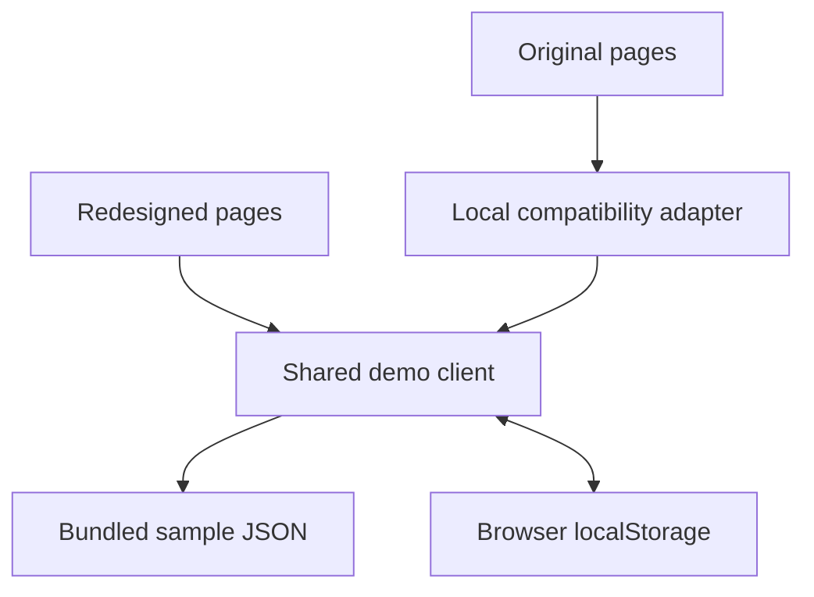

# Demo architecture

This personal design showcase runs both Pawprints presentations in one Next.js application. Its architecture supports comparing the user experience with the same local sample data.

## Separate website layouts

| Area | Source | Presentation |
| --- | --- | --- |
| Redesigned website | [Renewed routes](<../src/app/(renewed)>) | React screens, Bootstrap, the renewed stylesheet, and SVG illustrations. |
| Original website | [Original routes](<../src/app/(original)>) and [copied source](../src/old) | Original Pawprints 2 components, Tailwind styles, Inter font, and icons. |
| Comparison toggle | [Design switch](../src/components/design-provider.tsx) and [route mapping](../src/lib/design-routes.ts) | Opens matching old/new routes and retains relevant petition/query context. |

The route-group folder names do not appear in URLs. Redesigned routes include `/petitions`, `/create`, and `/profile`; original routes start with `/old`.

Each website has its own root layout. Switching performs a full navigation so one design's styles do not affect the other. Saved browser data survives that navigation; save unsaved form edits before switching.

## Shared local data

[demo-client.ts](../src/lib/demo-client.ts) implements local reading, filtering, pagination, example sessions, signatures, petition saves, committee drafts, and image attachments. Initial content comes from [demo.json](../src/data/demo.json).

The original components import a function named `fetch` from [local-fetch.ts](../src/old/local-fetch.ts). That adapter calls the shared demo client and returns the response shapes those components expect. It makes no network requests and is outside Next.js's route tree.

The shared [AuthProvider](../src/components/auth-provider.tsx) reads the selected fictional account. Both website layouts use the same session and storage key. This provides example-account behavior for the showcase.

## Source map

| Location | Responsibility |
| --- | --- |
| [src/components](../src/components) | Redesigned screens, shared account state, dialogs, rich editor, and artwork. |
| [src/lib](../src/lib) | Local data operations, shared types, navigation helpers, and petition metadata. |
| [src/data/demo.json](../src/data/demo.json) | Editable sample accounts, petitions, timelines, tags, signatures, and notice. |
| [src/old](../src/old) | Directly copied original frontend and its local adapters. |
| [public](../public) | Runtime logos, icons, and campus photographs. |
| [tests](../tests) | Local-data, access, navigation, metadata, and original-adapter tests. |

Rich text is handled with Lexical. Attached raster images are stored as data URLs. Server-generated share metadata reads public samples from the bundled JSON; it cannot read petitions saved only in a visitor's browser.

The demo has no API proxy, backend connection, database, institutional authentication, or administrative pages. [Original-source notes](../src/old/README.md) describe the retained source attribution and compatibility adjustments.
